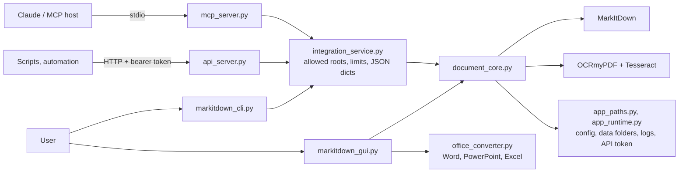

# Architecture

A short map of MarkitdownTool for contributors and Claude sessions. Update this file in the same PR when the module map, a main flow or an invariant changes. The module table in `CLAUDE.md` is the one-line version.

## Shape

Flat Python modules at the repository root, Windows-first, standard library first. One processing core serves four interfaces: the Tkinter app, the CLI, a local HTTP API and an MCP stdio server. PyInstaller builds two onefile executables (`markitdown_gui.exe`, console `markitdowntool.exe`); NSIS packages them with Tesseract.

## Module map

| Module | Role |
| --- | --- |
| `document_core.py` | Pipeline: `classify_file` (text layer quality, OCR need), `collect_supported_files`, `run_ocr`, `convert_markdown`, `process_batch` with progress and cancel. `SUPPORTED_EXTENSIONS` gates every interface |
| `integration_service.py` | Protocol-neutral service for CLI, API and MCP: `classify`, `convert`, `get_info`, `get_manifest`, `list_languages`; returns JSON-ready dicts and `ServiceError` codes. All path security: `allowed_roots`, `ensure_allowed_path`, `open_verified`, `integration_limits` |
| `markitdown_cli.py` | CLI `convert`, `classify`, `languages`, `info`, `api`, `mcp`; exit codes 0/1/2 |
| `api_server.py` | Local HTTP API on `http.server`: bearer token always required, loopback Host and JSON content-type checks |
| `mcp_server.py` | MCP stdio server (`mcp` 2.x `MCPServer`, structured output) |
| `markitdown_gui.py` | Tkinter app; Settings → Connection shows CLI/API/MCP snippets; update check against GitHub releases |
| `office_converter.py` | GUI-only conversion of legacy Office and OpenDocument files through installed Office: private temp copy, read-only, macros off, 60 s timeout; Mark-of-the-Web files refused |
| `language_manager.py` | Tesseract language packs in the per-user tessdata folder (downloads from `tesseract-ocr/tessdata_fast` on request) |
| `app_paths.py`, `app_runtime.py` | `APP_VERSION`, per-user data folders, config file, logging, API token file |
| `i18n.py` | UI strings as `(english, vietnamese)` pairs |
| `schemas/` | JSON Schemas of the integration outputs (`classify`, `convert`, `info`, `manifest`, `error`) |
| `markitdown_gui.spec`, `installer/` | PyInstaller spec and NSIS installer, `Build-Release.ps1` |

## Main flows

1. **App batch.** The user picks files or a folder; `document_core.process_batch` classifies each file, runs OCR when a PDF or image has no usable text layer, converts with MarkItDown and writes Markdown to the chosen output folder. Legacy Office files go through `office_converter` first.
2. **Integration call** (CLI, API, MCP). The interface parses the request and calls `integration_service`. Every caller-supplied path is checked by `ensure_allowed_path` against the allowed roots before any file-system call; inputs are expanded within limits (file count, size), then the same core runs. Legacy Office formats return `office_gui_only` (ADR-011).

## Invariants

- Every caller-supplied path (input, folder, `output_dir`) goes through `ensure_allowed_path` before any `pathlib` or file-system call; before that only string-only `os.path` functions are used.
- The final check in `ensure_allowed_path` stays `realpath` followed by an inline `startswith` guard on the same variable (CodeQL `py/path-injection`).
- UNC, WebDAV and device paths are refused before any I/O (NTLM leak).
- The API always requires the bearer token and refuses non-loopback Host headers.
- Office is driven only from the app, never from CLI, API or MCP; files from the internet zone are never opened with Office.
- MarkItDown only receives local files; remote images in HTML stay links.
- Every UI string has both languages (`tests/test_i18n.py`).

## Review habits

- Redraw the diagram above (or a richer one as an Artifact page) before each release and after a large refactor; note any drift from this file in the PR.
- Run `/security-review` before merging a code PR that touches `integration_service.py`, the API, MCP or CLI interfaces, `office_converter.py`, subprocess calls, network calls or `.claude/`. CodeQL runs on every PR.
